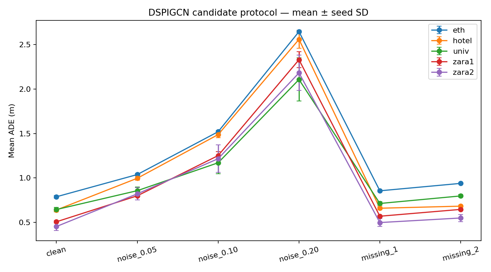

# Zhengyang Yan — DSPIGCN report section

**Status: candidate-protocol experiments; not yet a verified group comparison.**
The package implements the assigned data preparation, dual-stream model, training,
clean/perturbed evaluation, runtime measurement and visualization workflow. The
group contract and full paper have now been inspected. This candidate differs
from causal_v2 and the paper-based registered implementation. Its scores must
remain separate. See TEAM_INTEGRATION.md and PAPER_CHECK.md for details.

## Method

The two temporal-attention/graph-convolution streams process observed displacement
and velocity. Gaussian heads forecast 12 steps from 8 observations, at dt=0.4 s.
A fourth-order polynomial head couples integrated displacement and analytic
velocity; reconstruction, two Gaussian likelihood terms and physics residuals
are optimized jointly. Five train-only Gaussian-mixture anchors generate 20
sampled futures. This is a documented independent DSPIGCN variant; the GMM
sampler is a project variant, distinct from the paper's Algorithm 2.

All eligible continuous 20-frame trajectories, including nonlinear and singleton
cases, are retained. Training/validation are chronological, disjoint before
window generation, with a boundary gap. Checkpoint selection uses validation
mean-trajectory ADE. No test examples select hyperparameters or anchors.

## Clean accuracy

Errors below are meters; ± is sample standard deviation over training seeds.
MinADE and minFDE select whole samples independently per pedestrian. Mean
errors use every sample. A blank deviation means only one seed was available.

| Scene | Seeds | minADE | minFDE | meanADE | meanFDE | Energy score | Diversity |
|---|---:|---:|---:|---:|---:|---:|---:|
| eth | 3 | 0.417 ± 0.003 | 0.715 ± 0.015 | 0.788 ± 0.015 | 1.584 ± 0.035 | 2.216 ± 0.034 | 0.499 ± 0.019 |
| hotel | 3 | 0.265 ± 0.009 | 0.446 ± 0.027 | 0.639 ± 0.016 | 1.320 ± 0.044 | 1.565 ± 0.106 | 0.535 ± 0.069 |
| univ | 3 | 0.349 ± 0.013 | 0.668 ± 0.040 | 0.645 ± 0.026 | 1.366 ± 0.051 | 1.959 ± 0.070 | 0.383 ± 0.057 |
| zara1 | 3 | 0.262 ± 0.001 | 0.477 ± 0.007 | 0.507 ± 0.013 | 1.072 ± 0.022 | 1.385 ± 0.009 | 0.379 ± 0.030 |
| zara2 | 3 | 0.204 ± 0.012 | 0.383 ± 0.036 | 0.454 ± 0.046 | 0.978 ± 0.104 | 1.164 ± 0.011 | 0.380 ± 0.099 |

The gap between minimum and mean errors quantifies selection benefit under
the 20-sample budget. It does not by itself establish uncertainty calibration.

## Robustness

| Scene | Clean meanADE | Noise 0.20 m meanADE | Missing 2 meanADE |
|---|---:|---:|---:|
| eth | 0.788 ± 0.015 | 2.645 ± 0.015 | 0.939 ± 0.008 |
| hotel | 0.639 ± 0.016 | 2.558 ± 0.099 | 0.683 ± 0.014 |
| univ | 0.645 ± 0.026 | 2.107 ± 0.243 | 0.798 ± 0.015 |
| zara1 | 0.507 ± 0.013 | 2.329 ± 0.089 | 0.646 ± 0.012 |
| zara2 | 0.454 ± 0.046 | 2.182 ± 0.199 | 0.550 ± 0.040 |

Noise and missing suffixes are evaluated separately against unchanged future
targets. Corruptions use sample-addressed PCG64 draws; missing points use only
the last two visible observations. The constant-velocity residual uses the last
observed increment, so sensitivity to that increment is an architectural
hypothesis; these experiments do not isolate its causal contribution.

## Motion consistency

| Scene | Mean speed (m/s) | Mean acceleration (m/s²) | Mean jerk (m/s³) | Close-pair rate |
|---|---:|---:|---:|---:|
| eth | 1.201 ± 0.008 | 0.625 ± 0.025 | 2.707 ± 0.102 | 0.019 ± 0.000 |
| hotel | 0.502 ± 0.026 | 0.680 ± 0.088 | 2.927 ± 0.399 | 0.031 ± 0.001 |
| univ | 0.522 ± 0.011 | 0.504 ± 0.077 | 2.165 ± 0.332 | 0.008 ± 0.000 |
| zara1 | 0.943 ± 0.002 | 0.650 ± 0.037 | 2.831 ± 0.162 | 0.021 ± 0.001 |
| zara2 | 0.558 ± 0.013 | 0.522 ± 0.063 | 2.264 ± 0.280 | 0.038 ± 0.000 |

Exceedance thresholds are estimated from training data and saved per fold.
Close-pair rate is a simultaneous-pair diagnostic with an explicit denominator,
not a collision-avoidance guarantee. The GMM samples are not a learned joint
distribution over all pedestrians. Physical penalties constrain mean predictions;
they do not guarantee that every sampled trajectory is physically plausible.

## Selected failures

- eth: `biwi_eth.txt:9387`, meanADE 3.858 m; 1 simultaneous eligible people, largest target heading change 0.0°. [Trajectory figure](../results/provisional_main/eth_failure.png).
- hotel: `biwi_hotel.txt:14991`, meanADE 2.517 m; 1 simultaneous eligible people, largest target heading change 36.8°. [Trajectory figure](../results/provisional_main/hotel_failure.png).
- univ: `students003.txt:460`, meanADE 1.160 m; 20 simultaneous eligible people, largest target heading change 63.9°. [Trajectory figure](../results/provisional_main/univ_failure.png).
- zara1: `crowds_zara01.txt:4130`, meanADE 1.744 m; 2 simultaneous eligible people, largest target heading change 25.1°. [Trajectory figure](../results/provisional_main/zara1_failure.png).
- zara2: `crowds_zara02.txt:1850`, meanADE 2.300 m; 1 simultaneous eligible people, largest target heading change 25.4°. [Trajectory figure](../results/provisional_main/zara2_failure.png).

These are worst windows by meanADE, not examples chosen to favor the model.
Heading change and eligible crowd size describe observed failure context; they
do not prove that turning or interaction density caused the error.

## Runtime and reproducibility

Runtime records use 32 pedestrians, 20 samples, ten warmups and 100 repeats.
Graph construction is inside model prediction time; preprocessing and sampling
are separate. See `runtime.json` for hardware, device and measurement boundaries.
Entries below average each seed's median measurement; they are not speedups
relative to another model. Training seconds exclude GMM fitting and data preparation.

| Scene | Preprocess (ms) | Predict (ms) | Sample (ms) | Mean train (s) | Selected epochs |
|---|---:|---:|---:|---:|---|
| eth | 0.910 | 4.156 | 0.527 | 71.59 | 16, 27, 34 |
| hotel | 0.914 | 4.202 | 0.538 | 76.86 | 23, 10, 28 |
| univ | 0.900 | 4.181 | 0.531 | 102.57 | 44, 24, 46 |
| zara1 | 0.906 | 4.234 | 0.542 | 98.57 | 33, 46, 25 |
| zara2 | 0.916 | 4.188 | 0.531 | 116.75 | 54, 43, 35 |

Dependencies, seeds, parameter settings, validation history, population manifests,
checkpoints and exported predictions are retained in each original run directory.

Saved results contain 90 rows across 5 scenes. The audit must
pass for all expected 15 runs and 90 conditions before treating this candidate
matrix as complete. Matching the team's data and protocol is a separate gate.

## Limitations and outstanding integration

1. Source-code-guided implementation differs from the release in velocity input,
   physics coupling, reconstruction loss, tensor layouts and GMM sampling.
   Full-text review confirms these differences; see PAPER_CHECK.md.
2. The exact GMM sampling distribution is not the Gaussian training likelihood.
3. The provisional split, context selection and perturbations differ from causal_v2;
   no cross-model numerical superiority claim is supported yet.
4. Existing model code is preserved. The group-batch inference adapter provides
   tensor interoperability, not retrospective benchmark comparability.

References and AI coding assistance are acknowledged in THIRD_PARTY.md.

## Completed local audit

All 15 runs / 90 condition rows passed the saved-artifact audit, including
raw-source trajectory matching, corruptions, per-trajectory and aggregate
accuracy/motion scores, checkpoint selection, runtime settings and figures.
See [audit evidence](../results/provisional_main/audit.json). This does not verify the
candidate's equivalence to the group protocol or the paper equations.
